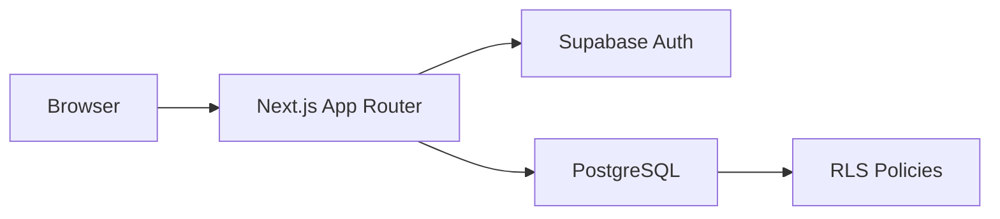

# ShiftFlow

ShiftFlow ist eine responsive Webanwendung zur Erfassung und Auswertung von
Arbeitsschichten. Nutzer:innen können Arbeitszeiten, Pausen, Stundenlohn und
Trinkgeld verwalten, Monatswerte vergleichen und ihre Daten als CSV, PDF oder
JSON-Backup exportieren.

Das Projekt entstand als eigenständiges Praxisprojekt, um einen alltäglichen
Prozess in ein strukturiertes Datenmodell und eine nutzbare Anwendung zu
überführen.

## Funktionen

- Registrierung und Anmeldung über Supabase Auth
- Schichten anlegen, bearbeiten und löschen
- automatische Berechnung von Arbeitszeit und Grundlohn
- Unterstützung von Schichten über Mitternacht
- Monatsdashboard für Stunden, Grundlohn, Trinkgeld und Gesamteinnahmen
- Jahresübersicht mit Diagrammen
- Abgleich zwischen berechneter und tatsächlicher Auszahlung
- CSV- und JSON-Export sowie druckbarer Monatsbericht
- persönliche Darstellungseinstellungen
- responsive Oberfläche und PWA-Manifest

## Architektur



Die Benutzeroberfläche basiert auf Next.js und TypeScript. Authentifizierung,
Persistenz und Zugriffskontrolle werden von Supabase übernommen. Sämtliche
Datensätze sind einer `user_id` zugeordnet; Row Level Security verhindert den
Zugriff auf Daten anderer Accounts.

## Tech-Stack

- Next.js 16 und React 19
- TypeScript im Strict Mode
- Tailwind CSS
- Supabase Auth und PostgreSQL
- Recharts
- Vercel-kompatibles Deployment

## Datenmodell

### `shifts`

| Feld | Bedeutung |
| --- | --- |
| `user_id` | Zuordnung zum angemeldeten Account |
| `employer`, `date` | Arbeitgeber und Arbeitstag |
| `start_time`, `end_time` | Beginn und Ende der Schicht |
| `pause` | Abzug einer 30-minütigen Pause |
| `hourly_rate`, `tips` | Stundenlohn und Trinkgeld |
| `hours`, `wage` | berechnete Dauer und Grundlohn |

### `monthly_payouts`

Speichert pro Account, Jahr und Monat den tatsächlich ausgezahlten Betrag.
Die Kombination aus `user_id`, `year` und `month` ist eindeutig.

## Lokal starten

Voraussetzungen: Node.js 20.9 oder neuer und ein Supabase-Projekt.

```bash
git clone https://github.com/gerstunghe106072/shiftflow.git
cd shiftflow
npm ci
cp .env.example .env.local
```

Anschließend:

1. Den Inhalt von
   `supabase/migrations/20261027000000_initial_schema.sql` im Supabase SQL
   Editor ausführen.
2. URL und Publishable Key des Supabase-Projekts in `.env.local` eintragen.
3. Die Anwendung starten:

```bash
npm run dev
```

Danach ist ShiftFlow unter [http://localhost:3000](http://localhost:3000)
erreichbar.

## Umgebungsvariablen

```env
NEXT_PUBLIC_SUPABASE_URL=https://your-project.supabase.co
NEXT_PUBLIC_SUPABASE_PUBLISHABLE_KEY=your-publishable-key
```

Der Publishable Key ist für Browser-Anwendungen vorgesehen. Ein Supabase
Service-Role-Key darf niemals in einer `NEXT_PUBLIC_`-Variable oder im
Repository gespeichert werden.

## Qualitätschecks

```bash
npm run lint
npm run typecheck
npm run build
```

## Entwicklungsansatz

KI-Werkzeuge wurden als Pair-Programming-Unterstützung für Recherche,
Refactoring und Fehlersuche eingesetzt. Vorschläge werden nicht ungeprüft
übernommen, sondern über TypeScript, ESLint, Produktions-Builds und manuelle
Funktionstests verifiziert. Architektur, Datenmodell und Produktentscheidungen
bleiben dabei nachvollziehbar dokumentiert.

## Nächste Schritte

- automatisierte Tests für Zeit- und Lohnberechnungen
- serverseitige Validierung der berechneten Werte
- Datenbankabfragen mit Zeiträumen statt vollständigem Client-Abruf
- generierte Supabase-Typen für durchgängige Typsicherheit
